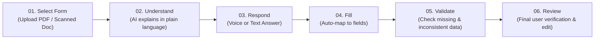
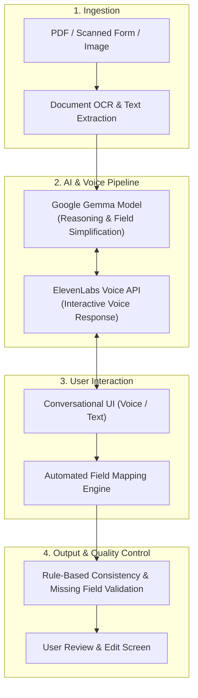

# 📝 FormSaathi — AI-Powered Voice-Guided Form Assistant

> **"Make complex forms easier for everyone, one question at a time."**

[](https://hacktoberfest.com/)
[](https://nextjs.org/)
[](https://www.typescriptlang.org/)
[](https://tailwindcss.com/)
[](https://ai.google.dev/gemma)
[](https://elevenlabs.io/)

---

## 📌 Overview

**FormSaathi** is an intelligent, voice-guided conversational assistant engineered to bridge the accessibility gap in digital paperwork. Official and legal forms are frequently riddled with bureaucratic jargon, intricate terminology, and confusing field requirements that intimidate everyday users and non-native speakers.

FormSaathi transforms overwhelming, multi-page documents and scanned forms into a clear, conversational dialogue. By breaking forms down question by question, simplifying instructions into everyday language (including regional Indian languages like Hindi), listening to spoken answers, and validating inputs before submission, FormSaathi empowers anyone to complete forms accurately and with confidence.

---

## 🚩 The Problem

* **Complex & Formal Language:** Standard government, civic, and financial forms use complex legal and bureaucratic terms that are hard to comprehend.
* **Language Barriers & Jargon:** Most digital forms lack multilingual conversational support, isolating users who are not fluent in formal English.
* **Costly Errors & Rejections:** Ambiguous field expectations often lead to missing data, formatting errors, and repeated form rejections.

---

## 💡 The Solution

**FormSaathi** reimagines digital form processing as a human-centered, guided experience:

* 🗣️ **Conversational Step-by-Step Guidance:** Tackles one question at a time instead of presenting intimidating multi-page layouts.
* 🌐 **Plain Language & Multilingual Clarification:** Explains complicated form requirements in simple, accessible terms (with Indian-language voice guidance, e.g., Hindi).
* 🎙️ **Dual-Mode Input (Voice & Text):** Users can respond naturally by speaking or typing.
* 🤖 **Intelligent Field Mapping:** Automatically interprets freeform spoken answers and maps them accurately to form attributes.
* ✅ **Proactive Validation:** Detects missing fields, discrepancies, and formatting issues prior to finalizing.
* 👁️ **Human-in-the-Loop Review:** Keeps users in full control with a final editable review screen before submission.

---

## 🔄 User Flow & Working



### 🎬 Demo Flow Scenario
$$\text{Open Sample Form} \longrightarrow \text{Explain Question in Hindi} \longrightarrow \text{Spoken Answer} \longrightarrow \text{Auto-Fill Field} \longrightarrow \text{Flag Missing Info} \longrightarrow \text{Display Reviewed Form}$$

---

## 🏗️ System Architecture



---

## 🚀 Key Features & Differentiators

| Feature | Description |
| :--- | :--- |
| **Conversational Filling** | Breaks monolithic forms into discrete, bite-sized questions. |
| **OCR & Document Ingestion** | Extracts text and structure from scanned PDFs and uploaded documents. |
| **Voice & Text Modalities** | Answer hands-free via speech-to-text or traditional text input. |
| **Plain Language Explainer** | Demystifies bureaucratic jargon into clear, everyday phrasing. |
| **Context-Aware Mapping** | Contextually parses conversational answers into structured form schema. |
| **Pre-Submission Validation** | Flags omitted fields and conflicting entries before submission. |
| **Human-Controlled Flow** | Every auto-filled field remains fully editable and transparent. |

> 🌟 **Key Differentiator:** FormSaathi uniquely unifies document understanding, OCR, conversational assistance, voice interaction, and automated validation into a single guided workflow.

---

## 💻 Tech Stack

### **Frontend & Backend**
* **Framework:** [Next.js](https://nextjs.org/) (React 18+) with App Router
* **Language:** [TypeScript](https://www.typescriptlang.org/)
* **Styling:** [Tailwind CSS](https://tailwindcss.com/)
* **API Layer:** Next.js Lightweight Serverless API Routes

### **AI & Voice Engine**
* **Language Model:** [Google Gemma](https://ai.google.dev/gemma) (via API / Inference endpoints)
* **Voice Synthesis & Interactive Audio:** [ElevenLabs API](https://elevenlabs.io/) (High-quality natural voice response)
* **Speech Recognition:** Web Speech API / Whisper STT

### **Document Extraction & Validation**
* **OCR & Document Parsing:** PDF extraction utilities & OCR engine
* **Field Mapping & Logic:** Rule-based consistency validation & JSON schema mapping

---

## 🛡️ Fallback Strategy (Demo Mode)

To ensure uninterrupted demonstrations during hackathons, API rate limiting, or network constraints:
* **Predefined Explanations:** Cached plain-language explanations for standard sample forms.
* **Simulated Voice Mode:** Built-in synthesized voice fallbacks and pre-recorded responses.
* **Sample Data Presets:** Demonstrates the complete happy-path workflow seamlessly even when external APIs are restricted.

---

## 📦 Getting Started

### Prerequisites
* [Node.js](https://nodejs.org/) (v18.0.0 or higher)
* [npm](https://www.npmjs.com/) or [pnpm](https://pnpm.io/) or [yarn](https://yarnpkg.com/)
* API Keys for Gemma AI & ElevenLabs (optional for demo fallback mode)

### 1. Clone the Repository
```bash
git clone https://github.com/HalwaCoded/FormSaathi.git
cd FormSaathi
```

### 2. Install Dependencies
```bash
npm install
```

### 3. Configure Environment Variables
Create a `.env.local` file in the root directory:
```env
# AI Model Configuration
GEMMA_API_KEY=your_gemma_api_key_here
GEMMA_API_ENDPOINT=https://api.example.com/v1

# Voice Configuration
ELEVENLABS_API_KEY=your_elevenlabs_api_key_here
ELEVENLABS_VOICE_ID=your_preferred_voice_id

# App Settings
NEXT_PUBLIC_ENABLE_FALLBACK_MODE=true
```

### 4. Run the Development Server
```bash
npm run dev
```

Open [http://localhost:3000](http://localhost:3000) in your browser to experience FormSaathi.

---

## 🎯 Feasibility & Future Scope

### Feasibility Focus (Hackathon MVP)
- [x] End-to-end happy path flow on curated sample forms.
- [x] PDF text extraction & OCR integration.
- [x] Multilingual plain-language guidance (Hindi & English).
- [x] Dynamic field mapping with fallback mode for high reliability.

### Future Roadmap
- 🇮🇳 **Broader Indic Language Support:** Add Tamil, Telugu, Bengali, Marathi, and Kannada speech models.
- 📑 **Complex Document Parsing:** Expand OCR to handle multi-column tables, checkboxes, and handwritten notes.
- 🏛️ **Public-Service Integrations:** Direct API connectors for civic portals, scholarships, and DigiLocker.
- 🔒 **Privacy & Data Security:** On-device zero-retention processing and confidential data redaction.

---

## 👥 The Team

**Team Name:** HalwaCoded  
**Team Leader:** Aditya Sah  
**Hackathon Event:** Hacktoberfest 26 (*MLH × DEV • Aki Hacks • Caltech Circle • Diversion 2k27*)

---

## 📄 License

This project is licensed under the [MIT License](LICENSE).
